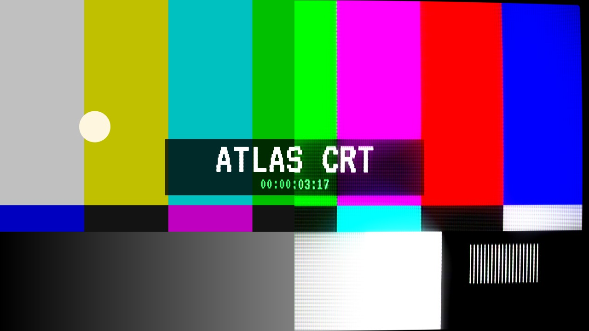

# ATLAS CRT

A CRT and analog video emulator that runs in the browser. Drop in a photo or a video, run it through a real VHS emulation, break it with fully customizable glitches, push it through stipple, screen print, iridescence and gradient maps, film it off a tube with real moiré, move any of it with keyframes or LFOs, then save a PNG or export an MP4.

Everything renders on the GPU with WebGL2, on your machine. Nothing is uploaded anywhere.



## Run it

Atlas CRT lives at atlas-crt.nathanetes.com
You can access the latest release there.

## Using it

1. Click **$ open photo/video** or drag a file onto the preview. The app starts on a built-in test card with the default settings, so you can see the effects right away.
2. On the **Looks** tab, shape the picture with the six quick macros (tube, glow, moiré, color, grime, corrupt). Each one scales a whole family of controls, and 1.00 leaves the look as it is. Looks you save appear here too.
3. On the **Adjust** tab, open any module for the full controls, or search for one by name. Double-click a control to reset it, or click its value to type one.
4. Click **Save still** for a PNG at the output size, or **Export video** to record.

The controls over the picture step back while a clip plays and you aren't moving the pointer.

| Key | Action |
| --- | --- |
| Space | Play or pause |
| ⌘Z, ⇧⌘Z | Undo and redo (Ctrl on Windows) |
| ← → | Nudge the playhead, or the selected keyframes, one frame (Shift for ten) |
| Delete | Delete the selected keyframes |
| Home | Go to the start |
| C | Compare: drag on the picture to move the split between source and result |
| Z | View output pixels at 100% |

**Raster** (under Render on the Looks tab) sets the resolution of the simulated signal: LO is 120 lines, SD is 240, HI is 480, and FULL works at the source resolution. **480i** is 480 lines drawn as two interlaced fields, one per frame: anything moving shows combing on its edges, and detail one line tall flickers (line twitter), as on an interlaced TV. Exports get one field per frame too. **Output** sets the export size. The preview renders at screen resolution, so use 100% to check fine detail like the phosphor mask.

### Details and motion

Every control has a small arrow beside its name. It opens a dropdown with the detail controls that belong to it, so a module opens simple and goes as deep as you want. Glitch Amount opens size, position, direction, movement, edges and color. Film Grain opens grain size, color and response.

Every numeric control also has **Motion** in its dropdown, so anything can misbehave on its own, on top of any keyframes or LFO:

| Control | What it does |
| --- | --- |
| Stutter, Stutter Rate | Jumps between random values |
| Jitter | Shakes the value every frame |
| Spikes, Spike Rate | Throws the value hard for a moment |
| Drift, Drift Rate | Lets the value wander |

### Glitches

Glitch 1 to 4 are four independent slots. For each, pick **Type**: Slice Shift, Block Shift, Line Hold, Mosaic, Pixel Sort, Sparkle Dashes, Streaks, RGB Tear, Freeze or Invert. Then set **How Often** and **How Long**, and open Amount's dropdown for Chance, Height, Width, Bands, Position, Random Position, Direction, Movement (Still, Jump, Scan Forward, Scan Back, Sway, Bounce), Move Speed, Stepped Edges, Color, Tint, Blend and Pattern.

### Automation

Click the diamond next to any control and choose **Keyframes** or an **LFO**. Each automated control gets a lane on the timeline, stacked like automation lanes in Ableton, and it keeps both sets of data, so you can switch between them without losing either.

**Keyframes.** Move the playhead and set the slider, and that value is keyed there. On a lane, double-click to add a keyframe or delete one, and drag to move it. Drag the small dot on a line to bend it. Drag across a lane to select several, and Shift-click to add to them. The panel to the right of the timeline shows the selected keyframe's exact time and value, and its velocity curve: drag the two handles, or pick ease in-out, linear, ease in, ease out, snap, overshoot or hold. The solid line is the value over the move, and the dashed line is its speed.

**LFOs** keep a control moving on its own, swinging around the slider's value. Pick a shape (sine, triangle, ramp, saw, square, random, drift, or draw your own), then shape it:

| Control | What it does |
| --- | --- |
| Rate | Cycles per second, 0.02 to 20 Hz. Random takes one step per cycle |
| Depth, Offset | How far it swings, and where the centre of the swing sits |
| Smooth | On Random, goes from hard steps to a continuous glide, like Ableton's LFO. On the other shapes it rounds the corners |
| Jitter | Drifts the timing so it never quite repeats |
| Bend, Symmetry | Warp the cycle, like Serum's Bend and Asym modes. Symmetry is the pulse width of a square |
| Phase, Steps | Where the cycle starts, and quantizing the output to a set number of levels |

**The timeline.** Videos automate on their own time. Photos and the test card get a timeline that loops, and **Length** sets how long it is. Exports play the same timeline from the start, so they match the preview. Scroll sideways to move along, hold ⌘ and scroll to zoom, and **Snap** sets what keyframes land on. Bypass a lane with its power button, and drag a lane's bottom edge to resize it.

### Undo and history

Undo and redo are in the top bar. The clock button next to them lists everything you've done since opening the page, so you can jump back to any point. History lasts until you reload the page.

### Settings

The sliders button opens Settings: System, Light, Dark or Terminal themes, any accent color, text size, the controls on either side, the timeline on top, on the bottom or hidden, and which modules show and in what order. Drag the gaps between panels to resize them. Pin any control to the top of Adjust from its automation popover.

### VHS tape

The **VHS Tape** and **NTSC Signal** modules run [ntsc-rs](https://github.com/valadaptive/ntsc-rs) itself, compiled to WebAssembly, not an imitation of it. The output matches the ntsc-rs app to within rounding (no pixel off by more than 1/255 in a direct comparison with version 0.9.7), and every one of its settings is here, with the same ranges and defaults.

Raise **VHS Amount** or pick a look from the top of the **Tape** group. The picture goes onto the tape before it reaches the TV, so everything downstream still works: **VHS Tape** on its own shows the tape with no tube at all, and **Living Room VHS** plays it on a set. While a tape plays, the raster opens up to at least its 480 lines.

To bring in a preset from the ntsc-rs app, use **Import** under Mine: it takes `.json` presets as well as Atlas looks, and adds each one as a look.

The tape runs on the CPU rather than the GPU, because its filters work along each scanline in order. It takes about 10 ms a frame at 640×480 on a recent Mac, and it updates 30 times a second. On a slow device, lower **Scanlines** in NTSC Signal.

## Modules

| Module | What it does |
| --- | --- |
| Pre Grade | Exposure, brightness, contrast, saturation, temperature, tint and hue on the source, before it reaches the tube |
| Color Signal | Signal path (RGB, S-Video or composite), luma bandwidth, brightness gain, chroma level, hue drift, chroma bleed, RGB split, sharpening, post glow, halation |
| Post Grade | Exposure, brightness, contrast, saturation, hue shift, temperature and tint on the finished picture, then shadow and highlight toning, gradient map, cross process, black level, gamma, solarize, posterize, invert, channel swap, grunge |
| VHS Tape | The tape deck, from ntsc-rs: VHS Amount, tape speed (SP, LP, EP), edge wave, head switching, tracking noise, chroma loss, sharpening, vertical chroma blend |
| NTSC Signal | The composite signal, from ntsc-rs: scanlines, fields, filter type, chroma low-pass, chroma demodulation, composite sharpening and noise, snow, luma smear, ringing, luma and chroma noise, chroma phase error and delay, bandwidth scale, random seed |
| Color FX | Burn, Iridescence (oil-slick thin film, with its tone range, bands, swirl and flow), Hue Cycle, Hue by Brightness, Hue Across Picture, Light Leak |
| Stipple & Print | Stipple (two colors through grain, down to a clean screen print, with Threshold, Detail, Softness, Grain, Paper Texture, Ink and Paper), Halftone |
| Channel Mixer | How much of each color goes into each output channel |
| Glitch 1 to 4 | Four custom glitch slots, see above |
| Warp | Bends the whole picture: Flow, Liquid, Horizontal Waves, Vertical Waves, Ripple, Swirl, Mirror Fold, Pinch & Bulge, with Scale, Speed, Turbulence and Stutter |
| Corrupt | Datamosh (block size, motion gain, drift, keyframes, residual), block glitch, slice shift, pixel smear with its own direction, compression, bit crush |
| Circuit Bend | A resonant stage that rings after edges and folds over. Direction, motion, frequency (MHz), Q, boost (dB), thresholds (IRE), feedback |
| Damage | Shake, tear, vertical roll, exposure flash, dropouts (5 styles), hum band, signal echo, head-switch band, top-line noise |
| Noise & Film | Film grain with size, mono-to-RGB color, shadow-to-highlight response and variation (clumping and breathing), dust and straight scratches with their own opacity, gate weave, tape grain in horizontal streaks, reception specks with their own opacity |
| Waves | Modulation bands with count, picture reaction, smoothing, direction and blend mode |
| Screen | Phosphor color, tube gamut, 5 mask types, mask scale (up to 36px triads) and phosphor strength (above 1 the gaps go black), scanlines, refresh rate, persistence, sync, supply ripple, flicker, beam softness, phosphor bloom, overscan |
| Capture | A camera filming the tube. Its sensor beats against a grid on the curved glass, so the rainbow fringes warp with the glass and the lens: rainbow moiré, moiré bands, moiré scale (single pixels to chunky), grid pattern, pixel visibility, moiré color, coverage (room light that carries the fringes into dark areas), tube curvature (how far the glass bulges toward the camera, which bends the fringes into rings toward the sides), camera position (left to right), density, angle, rings and drift. Works with or without the Screen mask. Plus the scan pulse: shutter against refresh, band angle, rolling-shutter readout |
| Convergence | Red, green and blue beams landing out of register |
| Glass & Optics | Glow with a long, soft tail, spectral bloom, curvature, vignette, line stretch, fisheye, transparent outside area |

Each module has its own on/off switch and reset.

### Signal and tube controls

- **Signal Path** (Color Signal): **RGB** keeps the picture clean. **S-Video** carries color on its own wire at reduced bandwidth. **Composite** puts color on a 3.58 MHz subcarrier mixed into the picture and decodes it again the way an inexpensive TV did, so fine detail turns into rainbow color (cross-color) and color edges get crawling dots (dot crawl).
- **Luma Bandwidth** (Color Signal): limits horizontal sharpness to a format's resolution: S-VHS (about 400 TV lines), broadcast NTSC (about 330), Betamax (about 250) or VHS (about 240). Post Sharpen then rings at the tape's own scale, like a deck's detail enhancer.
- **Moiré** (Capture): raising Rainbow Moiré or Moiré Bands from zero starts random LFOs on Moiré Angle, Tube Curvature, Camera Position and Moiré Rings. Fringe Contrast, Glass Ripple, Focus Falloff, Weave and Handheld Sway are what make it read as a camera rather than an overlay.
- **Tube Drive** (Screen): the set's contrast drive. 1.00 shows the signal at its true level, and factory looks use 1.30.
- **Tube Gamut** (Screen): **P22 · D65** (the default) shows color through CRT phosphors with a standard white point. **P22 · D93** adds the bluish white of many Japanese and consumer sets. **Modern (sRGB)** turns it off.
- **Persistence** (Screen): each phosphor fades at its own rate, so trails behind bright moving things lean red.

## Looks

54 factory looks in seven groups, built for the linear-light renderer, plus **Init** at the top of TV: every effect off, a blank slate to build your own look from. The app opens on Init the first time; after that it reopens on whatever you were last using.

- **Creative:** Stipple, Stipple Red, Screen Print, Acid Print, Red Room, Oil Slick, Expired Film, Burnt CRT, Data Rot, Slice Cinema, Sparkle Static, Liquid Dream
- **TV:** Living Room Tube, Broadcast Monitor, Tokyo Trinitron, Arcade Cabinet, Console on Composite, Big Pixel Max, Pastel Dream
- **Tape:** VHS Tape, VHS SP, VHS EP, Living Room VHS, VHS Camcorder, Rental Tape EP, Tracking Error, Haunted Tape and Broadcast NTSC run on ntsc-rs; Betamax Archive, S-VHS Master and Late Night Ad use Atlas's own signal path
- **Camera:** Pixel Moiré, Moiré Screen, Rainbow Streaks, Phone Off Screen, Rainbow Grille, Filmed Off TV, Rolling Shutter, 16mm Print, Night Shift
- **Terminal:** Terminal Glow, Green Phosphor, Amber Monitor, Paper White
- **Color:** Teal Night, Cross Processed, Duotone, Bleach Bypass
- **Glitch:** Datamosh Bloom, Bent Circuit, Loose Cable, Chroma Storm, Feedback Bloom, Lost Sync

Looks don't change the raster, so pick **480i** yourself for interlaced footage. Save your own looks under **Mine**. Saved looks keep settings and automation.

Saved looks live in your browser, at this exact address, with a backup copy in a second store that restores them if the first is cleared. To keep them safe anywhere, use **Export all** under Mine: it saves a `.json` file you can bring back with **Import**, on any device. Importing adds to what you have and never replaces it. Each look can also be exported on its own.
 The looks from before the linear-light renderer are kept for reference in `docs/presets-pre-linear.js`; the app doesn't load them.

## Exporting

**Quick** records in real time, as a screen recording would. **Pro** renders every frame in full, as fast or as slowly as it needs, so nothing drops however heavy the effects, and the tab can go to the back. It's usually faster than real time.

Pro sets the format (MP4 with H.264 or HEVC), frame rate, size, aspect ratio, crop or black bars, quality, color (Rec. 709 or Display P3), and for videos the sound: include or mute, sample rate and bitrate. Aspect Ratio also lives under Render, so the preview matches.

- **Quick export runs in real time.** A two-minute clip takes two minutes. Keep the tab in front, because browsers pause rendering in background tabs.
- **The format depends on the browser.** Chrome, Edge and Safari record MP4 (H.264). Firefox records WebM.
- **Sound is included** when the source is a video.
- **Stills export as a clip** as long as the timeline, with the effects moving. Set the length in the timeline or the export panel.
- **Transparency** from the Outside Screen setting is kept in PNG stills only.

## How it works

Each frame runs through these stages:

1. **Pre grade** (only when it changes something). The source is graded before anything else sees it.
2. **Datamosh** (only when it's on). The frame is split into blocks. Each block either refreshes from the new frame or drags the previous moshed frame along a motion vector estimated from the last two frames.
3. **Tape** (only while VHS Amount is up). The frame is read back from the GPU at the tape's resolution, run through ntsc-rs on the CPU and uploaded again, 30 times a second. It encodes the picture to a composite signal, records it to a simulated tape and plays it back.
4. **Signal.** Warp bends the picture first, then the source is drawn into a low-resolution raster in YIQ color, like a video signal. Luma band-limiting, timing errors, slices, macroblock glitches, compression, pixel smear, chroma bleed, circuit bending, dropouts, noise and waves happen here. The previous frame feeds back for phosphor persistence. In 480i, each frame redraws only one field and keeps the other from the frame before.
5. **Composite** (only with S-Video or Composite selected). The raster is encoded onto a color subcarrier at 752 samples per line (188 subcarrier cycles, 4 samples each) and decoded again, which produces cross-color and dot crawl.
6. **Glitch** (only while a slot is on). The four slots break the picture, so their damage still goes through the tube.
7. **Glow.** The picture is converted to linear light, downsampled and blurred at four sizes (1/4, 1/8, 1/16 and 1/32 of the output), which feed the glow, its long tail, halation and bloom.
8. **Screen.** The tube is drawn at output resolution in linear light, so light adds up as it does on a real screen: curvature and overscan, a beam per scanline that widens on bright lines, convergence error, the phosphor mask, glow and the tube gamut. Where moiré is on, a camera at export resolution photographs the grid and raster lines through a Bayer filter, and that photo multiplies the picture. Each photosite traces a ray to the curved glass (a sphere, or a cylinder for an aperture grille) and reads the grid where the ray lands, measured along the glass. The result is converted back to display values for the camera scan pulse, the post grade, creative color, Color FX, monochrome phosphor tint, film grain, dust and bit crush, and a light dither keeps dark gradients from banding.

Masks finer than a screen pixel are drawn as their average in the fitted preview, so it never shows aliasing that the export won't have.

## Project structure

```
index.html            page markup
src/styles.css        the interface: same design system as covrt and cobalt, with Atlas's own accent
src/shaders.js        GLSL for the datamosh, signal, composite and blur passes
src/screen-shader.js  GLSL for the screen pass, grade, Color FX and film
src/glitch-shader.js  GLSL for the four glitch slots
src/engine.js         WebGL2 setup, render targets and the pass order
src/vhs.js            the tape stage: maps controls to ntsc-rs settings and runs it
src/vhs.wasm          ntsc-rs compiled to WebAssembly (built from native/vhs)
src/params.js         every control (range, default), the quick macros and the looks
src/automation.js     the maths of keyframe curves and LFOs
src/app.js            the timeline clock, media loading, render loop, transport
src/history.js        undo, redo and the history list
src/rack.js           the controls: tabs, macros, modules, the automation popover, saved looks
src/timeline.js       the automation lanes and the velocity curve editor
src/settings.js       appearance and layout
src/export.js         PNG stills, real-time recording and frame-by-frame Pro rendering
src/mp4.js            writes the MP4 file for Pro export
native/vhs/           the small Rust wrapper around ntsc-rs, and build.sh to rebuild src/vhs.wasm
docs/                 images for this README, the previous factory looks, third-party licenses
```

### Adding a look

Add an entry to `PRESETS` in `src/params.js`, and add its group name to `CATS` in the same file. Any control you leave out uses its default.

```js
{ cat: 'TV', name: 'My Look', p: { curve: 0.4, glow: 0.5, scanlines: 0.7, maskType: 2 } },
```

Control keys and their ranges are listed at the top of `src/params.js`. A look can also carry automation in `auto`, as keyframes or an LFO:

```js
auto: {
  glow: { mode: 'keys', keys: [{ t: 0, v: 0.2, ease: [0.42, 0, 0.58, 1] }, { t: 4, v: 0.8, ease: 'hold' }] },
  moireView: { mode: 'lfo', lfo: { wave: 'random', rate: 0.23, depth: 0.55, smooth: 1, seed: 8.2 } },
}
```

`t` is in seconds, and `ease` is the curve out of that keyframe: the two handles of a cubic Bézier, or `'hold'`. The LFO's fields are listed in `src/automation.js`.

## Rebuilding the tape stage

`src/vhs.wasm` is checked in, so nothing needs building to run the site. To rebuild it, install Rust and run:

```bash
rustup target add wasm32-unknown-unknown
```

```bash
./native/vhs/build.sh
```

## Browser support

Atlas CRT needs WebGL2, which current Chrome, Edge, Safari and Firefox all support. It opens any video format the browser can decode: H.264 MP4 and WebM everywhere, and HEVC `.mov` in Safari and in Chrome on macOS.

The interface shares its design with [covrt](https://covrt.nathanetes.com) and [cobalt](https://cobalt.nathanetes.com). The Terminal theme uses the Nathan Etes Terminal design system and the [VT323](https://fonts.google.com/specimen/VT323) typeface from Google Fonts.

## Credits

The VHS Tape and NTSC Signal modules are [ntsc-rs](https://github.com/valadaptive/ntsc-rs) by valadaptive, compiled to WebAssembly. Its license is in `docs/licenses/ntsc-rs.txt`.

The composite video encode and decode follows the approach of [Cathode Retro](https://github.com/DeadlyRedCube/Cathode-Retro) by DeadlyRedCube. Its license and notice are in [docs/licenses/cathode-retro.txt](docs/licenses/cathode-retro.txt).

CRT Effect made with Claude Ultracode ( because i do not know how to code )
