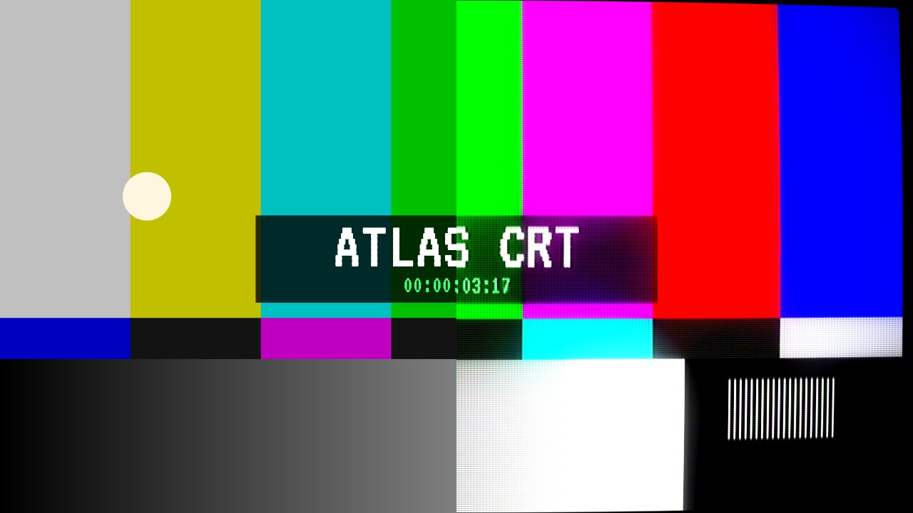
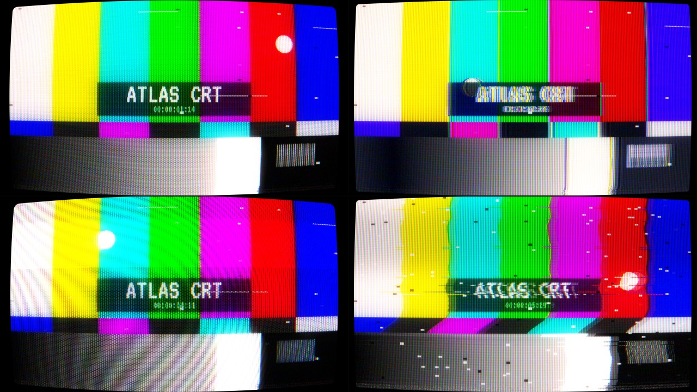

# ATLAS CRT

A CRT and analog video emulator that runs in the browser. Drop in a photo or a video, dial in signal damage, phosphor masks, scanlines and glass glow, then save a PNG or export an MP4.

Everything renders on the GPU with WebGL2, on your machine. Nothing is uploaded anywhere.



## Run it

There is no build step and there are no dependencies. Serve the folder with any static server:

```bash
python3 -m http.server 8000
```

Then open http://localhost:8000.

### Host it on GitHub Pages

1. Push this repo to GitHub.
2. Go to **Settings → Pages**.
3. Under **Build and deployment**, choose **Deploy from a branch**, then `main` and `/ (root)`.

The app will be live at `https://<your-username>.github.io/<repo-name>/`.

## Using it

1. Click **$ open photo/video** or drag a file onto the preview. The app starts on a built-in test card so you can see the effects right away.
2. Pick a look, or open the modules and adjust them. Double-click any control to reset it.
3. Click **$ save still** for a PNG at the output size, or **$ export video** to record.

| Key | Action |
| --- | --- |
| Space | Play or pause |
| C | Compare: drag on the picture to move the split between source and result |
| Z | View output pixels at 100% |

**Raster** sets the resolution of the simulated signal: SD is 240 lines, HI is 480 lines, and FULL works at the source resolution. **Out** sets the export size. The preview renders at screen resolution, so use 100% to check fine detail like the phosphor mask.

## Modules

| Module | What it does |
| --- | --- |
| Color Signal | Brightness gain, chroma level, hue drift, chroma bleed, RGB split, sharpening, post glow, halation |
| Circuit Bend | A resonant stage that rings after edges and folds over. Frequency (MHz), Q, boost (dB), thresholds (IRE), feedback |
| Damage | Shake, tear, vertical roll, exposure flash, dropouts (5 styles), hum band, signal echo, head-switch band, top-line noise |
| Noise | Reception specks with adjustable size, tape grain |
| Waves | Modulation bands with count, picture reaction, smoothing, direction and blend mode |
| Screen | Phosphor color, 5 mask types, mask scale and strength, scanlines, refresh rate, persistence, sync, supply ripple, flicker, beam softness, phosphor bloom, overscan |
| Capture | A camera filming the tube: shutter against refresh, band angle, rolling-shutter readout, moiré, rainbow interference |
| Convergence | Red, green and blue beams landing out of register |
| Glass & Optics | Glow, spectral bloom, curvature, vignette, line stretch, fisheye, transparent outside area |

Each module has its own on/off switch and reset.

## Looks

22 factory looks in four groups: Terminal, Camera, TV and Glitch. Save your own under **mine**. Saved looks keep settings only and live in your browser's local storage.



*From top left: Living Room Tube, Bent Circuit, Filmed Off TV, Loose Cable.*

## Exporting

- **Video export runs in real time.** A two-minute clip takes two minutes. Keep the tab in front, because browsers pause rendering in background tabs.
- **The format depends on the browser.** Chrome, Edge and Safari record MP4 (H.264). Firefox records WebM.
- **Sound is included** when the source is a video.
- **Stills export as a clip** of the length you pick (5 to 30 seconds), with the effects moving.
- **Transparency** from the Outside Screen setting is kept in PNG stills only.

## How it works

Each frame runs through three stages:

1. **Signal.** The source is drawn into a low-resolution raster in YIQ color, like a composite video signal. Timing errors, chroma bleed, circuit bending, dropouts, noise and waves happen here. The previous frame feeds back for phosphor persistence.
2. **Glow.** The signal is downsampled and blurred at two sizes (1/4 and 1/8 of the output), which feed the glow, halation and bloom.
3. **Screen.** The tube is drawn at output resolution: curvature and overscan, a beam per scanline that widens on bright lines, convergence error, the phosphor mask, glow, the camera scan pulse, then the grade and phosphor color.

Masks finer than a screen pixel are drawn as their average in the fitted preview, so it never shows aliasing that the export won't have.

## Project structure

```
index.html       page, styles and markup
src/shaders.js   GLSL for the signal, blur and screen passes
src/engine.js    WebGL2 setup, render targets and the pass order
src/params.js    every control (range, default) and the factory looks
src/app.js       media loading, render loop, transport, controls, saved looks
src/export.js    PNG stills and video recording
docs/            images for this README
```

### Adding a look

Add an entry to `PRESETS` in `src/params.js`. Any control you leave out uses its default.

```js
{ cat: 'TV', name: 'My Look', p: { curve: 0.4, glow: 0.5, scanlines: 0.7, maskType: 2 } },
```

Control keys and their ranges are listed at the top of `src/params.js`. `cat` must be one of the groups in `CATS` in `src/app.js`.

## Browser support

Atlas CRT needs WebGL2, which current Chrome, Edge, Safari and Firefox all support. It opens any video format the browser can decode: H.264 MP4 and WebM everywhere, and HEVC `.mov` in Safari and in Chrome on macOS.

The interface uses the Nathan Etes Terminal design system and the [VT323](https://fonts.google.com/specimen/VT323) typeface from Google Fonts.

CRT Effect made with Claude Ultracode ( because i do not know how to code )
